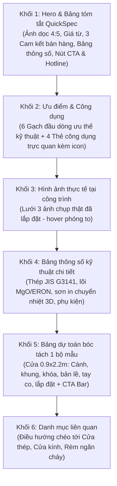

# TIÊU CHUẨN & PROMPT MẪU: BỔ SUNG DÒNG SẢN PHẨM CỬA THÉP VÂN GỖ CHỐNG CHÁY

> **Tài liệu tham chiếu:** `AGENTS.md`, `docs/GO-LIVE-STATUS.md`, `docs/PROMPT-TRANG-CHI-TIET-DANH-MUC.md`.  
> **Áp dụng cho:** Website APEX Việt Nam (`https://apexhome.vn`).

---

## MỤC LỤC
1. [Định vị & Usecase Kỹ thuật](#1-định-vị--usecase-kỹ-thuật)
2. [Quy chuẩn Template 6 Khối (Category Landing Page)](#2-quy-chuẩn-template-6-khối-category-landing-page)
3. [Quy chuẩn Nguồn ảnh & Xử lý Kỹ thuật số](#3-quy-chuẩn-nguồn-ảnh--xử-lý-kỹ-thuật-số)
4. [Bản đồ File Cần Thay đổi (Codebase Mapping)](#4-bản-đồ-file-cần-thay-đổi-codebase-mapping)
5. [Prompt Thực thi Chuẩn cho AI Agent (Copy-Paste)](#5-prompt-thực-thi-chuẩn-cho-ai-agent-copy-paste)
6. [Tiêu chí Nghiệm thu (Definition of Done)](#6-tiêu-chí-nghiệm-thu-definition-of-done)

---

## 1. ĐỊNH VỊ & USECASE KỸ THUẬT

### 1.1. Thông số cơ bản
* **Tên dòng sản phẩm:** Cửa Thép Vân Gỗ Chống Cháy (hoặc *Cửa Thép Vân Gỗ Ngăn Cháy*).
* **Mã định danh (Slug):** `cua-thep-van-go`.
* **Nhóm phân loại:** **Nhóm 1 — Cửa & Giải Pháp Ngăn Cháy** (cùng với Cửa thép ngăn cháy, Cửa kính ngăn cháy, Cửa cuốn ngăn cháy, Rèm ngăn cháy).
* **Cấp độ chịu lửa:** **EI60 — EI70 — EI90** (theo QCVN 06:2022/BXD và Sửa đổi 1:2023, TCVN 9383:2012).
* **Bảo hành:** 36 tháng đối với bề mặt vân gỗ, 24 tháng đối với cơ cấu khóa và phụ kiện.

### 1.2. Usecase & Khách hàng mục tiêu
* **Căn hộ chung cư cao cấp:** Cửa ra vào chính của từng căn hộ — vừa đáp ứng nghiêm ngặt nghiệm thu PCCC hành lang thoát nạn, vừa có vân gỗ sang trọng như cửa gỗ tự nhiên.
* **Biệt thự & Nhà phố liền kề:** Cửa đại sảnh, cửa phòng kỹ thuật, cửa thông tầng hầm yêu cầu tính năng ngăn cháy cách nhiệt nhưng phải đồng bộ phong cách nội thất gỗ.
* **Khách sạn & Khu nghỉ dưỡng:** Cửa phòng lưu trú đạt chuẩn PCCC ngành du lịch, cách âm 35–40dB, chống ẩm và không cong vênh trước điều hòa/thời tiết.
* **Văn phòng ban giám đốc / phòng dữ liệu server:** Cửa bảo vệ tài sản, ngăn cháy lan, tích hợp khóa vân tay / thẻ từ điện tử.

---

## 2. QUY CHUẨN TEMPLATE 6 KHỐI (CATEGORY LANDING PAGE)

Trang chi tiết danh mục `/san-pham/cua-thep-van-go` được xây dựng theo kiến trúc 6 khối thống nhất:



### Chi tiết nội dung chuẩn:

#### Khối 1 — Hero & QuickSpec
* **Ảnh cover:** Tỉ lệ dọc `4:5` (1200×1500px), thấy trọn cánh và khung cửa, nền gọn gàng.
* **Giá từ:** `2.150.000 đ/m²` (chưa gồm VAT).
* **3 Cam kết bán hàng (Selling Points):**
  1. Đạt kiểm định PCCC EI60 – EI90 theo QCVN 06:2022/BXD.
  2. Công nghệ in truyền nhiệt vân gỗ 3D bền màu trên 15 năm.
  3. Chống cong vênh, mối mọt, cách âm và ngăn khói tuyệt đối.
* **Bảng QuickSpec (7 thông số nhanh):**
  * *Cấp độ ngăn cháy:* EI60 / EI70 / EI90
  * *Loại cửa:* 1 cánh đơn & 2 cánh đôi (đều hoặc lệch)
  * *Cánh cửa:* Dày 50mm, thép mạ điện cán nguội 0.8 – 1.0mm (JIS G3141)
  * *Khung cửa:* Thép cán nguội 1.2 – 1.5mm, hèm tăng cứng 1.5 – 2.0mm
  * *Lõi cách nhiệt:* Tấm Magie Oxit (MgO) / ERON chống cháy, tỷ trọng 350–450 kg/m³
  * *Bề mặt:* Sơn tĩnh điện in chuyển nhiệt vân gỗ tự nhiên (Lim, Gõ đỏ, Sồi, Óc chó)
  * *Bảo hành:* 36 tháng
* **2 Nút CTA:** `Nhận báo giá dự toán` (mở Modal) và `Tư vấn Zalo` (kết nối kỹ sư).

#### Khối 2 — Ưu điểm & Công dụng
* **6 Gạch đầu dòng ưu điểm:**
  1. Khả năng chịu lửa EI60 – EI90, đã thử nghiệm và cấp giấy chứng nhận kiểm định PCCC.
  2. Bề mặt vân gỗ tinh xảo, chân thực, khắc phục hoàn toàn nhược điểm co ngót, ẩm mốc, mối mọt của gỗ tự nhiên.
  3. Thép tấm mạ điện tiêu chuẩn JIS G3141 chống gỉ sét, kết cấu hàn gia cường chống xệ cánh.
  4. Hệ gioăng cao su chống va đập kết hợp gioăng ngăn khói nở nhiệt, tự phồng bịt kín khe cửa khi gặp nhiệt độ cao.
  5. Khả năng cách âm vượt trội (35–40dB), đóng mở êm nhẹ nhờ bản lề inox 304 4 vòng bi.
  6. Tương thích hoàn toàn với các dòng khóa thông minh (vân tay, thẻ từ, mật mã) và khóa cơ an toàn.
* **4 Thẻ công dụng (Cards):**
  * `Ngăn lửa & khói độc` (icon: `flame`): Đóng kín khoang cháy căn hộ, ngăn khói độc xâm nhập hành lang thoát nạn.
  * `Cách âm & tiêu âm` (icon: `volume`): Tạo không gian yên tĩnh tuyệt đối cho căn hộ và phòng ngủ gia đình.
  * `Thẩm mỹ kiến trúc` (icon: `sparkles` / `scan`): Đem lại vẻ đẹp ấm cúng, sang trọng, hài hòa với nội thất gỗ cao cấp.
  * `Bền vững & an ninh` (icon: `shield`): Lõi thép kiên cố chống cạy phá, chống trộm, không biến dạng sau nhiều năm sử dụng.

#### Khối 3 — Hình ảnh thực tế tại công trình
* Lưới 3 ảnh thực tế chụp tại công trình đã bàn giao (cửa 1 cánh căn hộ, cửa 2 cánh đại sảnh, cận cảnh vân gỗ và khóa).

#### Khối 4 — Bảng thông số kỹ thuật chi tiết
* *Tiêu chuẩn áp dụng:* QCVN 06:2022/BXD, QCVN 03:2023/BCA, TCVN 9383:2012.
* *Kích thước chế tạo:* Sản xuất theo kích thước ô chờ thực tế (rộng 700–1200mm/cánh, cao 1900–2400mm).
* *Vật liệu khung & cánh:* Thép mạ kẽm/mạ điện cán nguội JIS G3141.
* *Lớp cách nhiệt:* Tấm MgO không chứa amiăng, không sinh khói độc khi tiếp xúc lửa.
* *Công nghệ vân gỗ:* Sơn lót tĩnh điện chống gỉ $\rightarrow$ Dán màng in vân gỗ $\rightarrow$ Hút chân không truyền nhiệt $\rightarrow$ Phủ bóng Nano chống trầy xước.
* *Phụ kiện tiêu chuẩn:* Bản lề inox SUS304 4 vòng bi (3–4 cái/cánh), khóa tay gạt Inox / khóa điện tử, tay co thủy lực King/Dorma, mắt thần góc rộng 180°, chốt âm (cửa 2 cánh).

#### Khối 5 — Dự toán mẫu bóc tách cho 1 bộ cửa căn hộ chuẩn (0.9 × 2.2m)
| Hạng mục | ĐVT | SL | Đơn giá (đ) | Thành tiền (đ) |
| :--- | :---: | :---: | :---: | :---: |
| Cửa thép vân gỗ EI70 (Cánh + Khung dày 50mm, thép 0.8/1.2mm) | m² | 1.98 | 2.150.000 | 4.257.000 |
| Bản lề Inox SUS304 chịu lực 4 vòng bi | Cái | 3 | 95.000 | 285.000 |
| Khóa cơ tay gạt an toàn Inox 304 | Bộ | 1 | 650.000 | 650.000 |
| Tay co thủy lực tải trọng 65–85kg | Bộ | 1 | 520.000 | 520.000 |
| Mắt thần quan sát góc rộng 180° | Cái | 1 | 90.000 | 90.000 |
| Gioăng cao su giảm chấn & gioăng ngăn khói nở nhiệt | Bộ | 1 | 150.000 | 150.000 |
| Nhân công lắp đặt, bắn keo bọt PCCC và hoàn thiện | Bộ | 1 | 550.000 | 550.000 |
| **Cộng 01 bộ cửa hoàn chỉnh (VNĐ)** | | | | **6.502.000** |

*Ghi chú: Đơn giá tạm tính cho 1 bộ mẫu tại Hà Nội, chưa gồm thuế VAT 8% hoặc 10%. Với công trình số lượng lớn, chiết khấu dự án từ 5% – 12%.*

#### Khối 6 — Danh mục liên quan
* Liên kết chéo: `cua-thep-ngan-chay`, `cua-kinh-ngan-chay`, `rem-ngan-chay`.

---

## 3. QUY CHUẨN NGUỒN ẢNH & XỬ LÝ KỸ THUẬT SỐ

### 3.1. Phân loại ảnh nguồn (trong thư mục `D:\ELMICH\Apex-pccc\ảnh`)
* **Nhóm G3 (Vân gỗ sáng):** Các file `1791877528973`, `1791877528976`, `1791877528978`, `1791877528980`, `1791877528982`, `1791877528984`, `1791877528986`, `1791877528988`.
* **Nhóm G5 (Vân gỗ tối panel):** Các file `1791877528992`, `1791878222859`, `1791878222868`, `1791878222872`.

### 3.2. Quy chuẩn kỹ thuật xử lý ảnh (bằng Sharp)
* **Định dạng:** WebP (quality 78–80).
* **Ảnh cover:** Tỉ lệ `4:5` (kích thước `1200 × 1500px`), crop căn giữa cửa, dung lượng **$\le$ 200 KB**.
* **Ảnh gallery/công trình:** Cạnh dài tối đa `1600px`, giữ nguyên tỉ lệ gốc, dung lượng **$\le$ 300 KB**.
* **Xóa Metadata:** Tuyệt đối xóa sạch EXIF, toạ độ GPS, ngày giờ chụp của điện thoại.
* **Crop chữ đè:** Nếu dùng ảnh nhóm G5 có chữ ngày giờ/tọa độ đè ở góc phải, phải crop bỏ triệt để trước khi xuất ảnh.
* **Thư mục đích:** `src/assets/images/products/`:
  - `cua-thep-van-go-cover.webp`
  - `cua-thep-van-go-2.webp`
  - `cua-thep-van-go-3.webp`
  - `cua-thep-van-go-4.webp`

---

## 4. BẢN ĐỒ FILE CẦN THAY ĐỔI (CODEBASE MAPPING)

| STT | File cần sửa | Nhiệm vụ cụ thể |
| :---: | :--- | :--- |
| 1 | `src/types/index.ts` | Thêm `'cua-thep-van-go'` vào `ProductCategory` union type |
| 2 | `src/data/categoryDetails.ts` | Khai báo object chi tiết 6 khối cho `cua-thep-van-go` |
| 3 | `src/components/products/ProductCategoryGrid.tsx` | Thêm thẻ danh mục vào Nhóm 1 của lưới sản phẩm |
| 4 | `src/routing.ts` | Thêm vào `PRODUCT_CATEGORIES`, `PRODUCT_CATEGORY_LABELS`, `SEO` |
| 5 | `src/data/mockData.ts` & `initialProducts.json` | Khai báo sản phẩm mẫu 1 cánh & 2 cánh vân gỗ |
| 6 | `sql/migrations/20261015_...sql` | Tạo file migration cập nhật `CHECK constraint` trên Neon DB |
| 7 | `public/sitemap.xml` | Thêm URL `https://apexhome.vn/san-pham/cua-thep-van-go` |
| 8 | `index.html` | Thêm Structured Data (Schema.org) Product JSON-LD |
| 9 | `scripts/test_integrity.js` | Cập nhật bộ test kiểm tra danh sách category hợp lệ |

---

## 5. PROMPT THỰC THI CHUẨN CHO AI AGENT (COPY-PASTE)

```markdown
Bạn đang làm việc trên repo APEX VN (d:\ELMICH\Apex-pccc\website-PCCC-main).
Trước khi thực hiện bất kỳ lệnh nào, đọc kỹ AGENTS.md và docs/TIEU-CHUAN-VA-PROMPT-CUA-THEP-VAN-GO.md.

YÊU CẦU:
Bổ sung dòng sản phẩm mới "Cửa Thép Vân Gỗ Chống Cháy" (slug: cua-thep-van-go) theo đúng tiêu chuẩn 6 khối đang áp dụng cho "Cửa Thép Ngăn Cháy" và "Cửa Kính Ngăn Cháy".

CÁC BƯỚC THỰC HIỆN:
1. Xử lý ảnh thật từ thư mục D:\ELMICH\Apex-pccc\ảnh:
   - Dùng ảnh vân gỗ nhóm G3/G5 có sẵn.
   - Dùng script Sharp xuất ra WebP: cua-thep-van-go-cover.webp (4:5, 1200x1500px, <= 200KB) và các ảnh phụ cua-thep-van-go-2.webp, 3.webp.
   - Xóa bỏ toàn bộ EXIF/GPS metadata.

2. Cập nhật mã nguồn hệ thống:
   - src/types/index.ts: Cập nhật ProductCategory union type thêm 'cua-thep-van-go'.
   - src/data/categoryDetails.ts: Thêm đầy đủ 6 khối dữ liệu cho 'cua-thep-van-go' đúng theo bảng tiêu chuẩn (Giá từ 2.150.000 đ/m², quickSpec 7 dòng, 6 advantages, 4 uses, specTable, bảng dự toán bóc tách 1 bộ mẫu 6.502.000 đ, relatedSlugs).
   - src/components/products/ProductCategoryGrid.tsx: Thêm vào PRODUCT_CATEGORY_DEFINITIONS thuộc Nhóm 1 (Cửa & Giải Pháp Ngăn Cháy).
   - src/routing.ts: Cập nhật Set PRODUCT_CATEGORIES, PRODUCT_CATEGORY_LABELS, SEO meta description.
   - src/data/mockData.ts & src/data/initialProducts.json: Thêm sản phẩm con mẫu (Cửa thép vân gỗ 1 cánh EI70, Cửa thép vân gỗ 2 cánh EI90).
   - sql/migrations/20261015_add_wood_grain_door_category.sql: Tạo migration cập nhật CHECK constraint cho bảng products trên Neon DB.
   - public/sitemap.xml: Bổ sung URL sitemap cho /san-pham/cua-thep-van-go.
   - index.html: Thêm Schema.org Product markup cho Cửa thép vân gỗ.

3. Kiểm thử & Nghiệm thu:
   - Cập nhật scripts/test_integrity.js để kiểm tra danh mục mới.
   - Chạy 'node scripts/test_integrity.js' -> phải PASS 100%.
   - Chạy 'npm run lint' (tsc --noEmit) -> 0 lỗi.
   - Chạy 'npm run build' -> bundle Vite thành công.
   - Cập nhật docs/GO-LIVE-STATUS.md.
```

---

## 6. TIÊU CHÍ NGHIỆM THU (DEFINITION OF DONE)

Một tác vụ thêm dòng sản phẩm Cửa Thép Vân Gỗ Chống Cháy chỉ được coi là hoàn tất khi đáp ứng đầy đủ các tiêu chuẩn sau:

1. **Hiển thị trực quan (Visual UX):**
   * Truy cập `https://apexhome.vn/san-pham/cua-thep-van-go` hiển thị đầy đủ 6 khối mượt mà.
   * Menu Sản phẩm trên Header hiển thị dòng "Cửa thép vân gỗ chống cháy", bấm vào chuyển thẳng tới trang chi tiết danh mục.
   * Lưới 10 dòng sản phẩm tại `/san-pham` cân đối, hiển thị tag "Thẩm Mỹ & An Toàn", nút "Xem chi tiết & dự toán" hoạt động chuẩn xác.
2. **Kỹ thuật & Dữ liệu:**
   * Ảnh cover chuẩn dọc `4:5`, không méo hình, không vỡ nét, không còn metadata GPS.
   * Modal Báo giá dự toán (`QuoteModal`) nhận diện đúng preselected category là `cua-thep-van-go`.
   * File migration SQL sẵn sàng để áp dụng cho Neon DB khi cần.
3. **Chất lượng mã nguồn:**
   * `node scripts/test_integrity.js` trả về **100% PASS**.
   * `tsc --noEmit` đạt **0 lỗi**.
   * `npm run build` tạo bundle sạch trong `dist/`.
